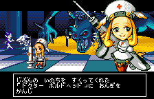

# Guilty Gear Petit 2 — English Translation

An English fan localization of **Guilty Gear Petit 2** for **WonderSwan Color**. The project makes its story, battle dialogue and move lists accessible in natural North American English while preserving the characters, humor and gameplay.

## Goals

- Translate faithfully, with grammatical English and consistent Guilty Gear terminology.
- Preserve character voices, jokes and scene context.
- Keep text within the original display fields and preserve readable native move-input symbols.
- Support emulators and WonderSwan Color flash-cartridge use, with documented compatibility repairs.
- Share comparison screenshots and a bilingual catalog so players can review and improve the localization.

## Status

**v0.1 is the first production release**, based on the approved graphics-repair build.

The bilingual catalog contains **1,731 records**: 953 story/tutorial/results/password pages, 72 battle captions, 554 move names/input strings/headings, and 151 native-English/UI records. The patch adds English variable-width text, corrects menu wording, and preserves the original yellow arrows and button glyphs at their native size. The character-select prompt reads “Please choose your character”.

The build also includes physical-bank and caption-upload compatibility fixes, a scrolling-banner repair, and a display-only health-bar path using the original tiles and actual health. Health bars drop immediately; damage and health simulation remain unchanged.

Docker qualification covers the recovered text, thirteen normal Story starts, menu and command-list checks, paired gameplay checks, native input pixels, and bounded graphics/slot diagnostics. The patch reproduces the approved ROM exactly. These checks do not establish every physical setup or complete natural playthrough coverage. Independent fluent-Japanese review, full Story/hidden-character routes, link play, exhaustive move execution and long-run save/audio testing remain open. Release notes document the exact scope and known limits.

## Preview

| Japanese | English |
| --- | --- |
|  |  |

The downloadable offline gallery contains more original/English comparisons and diagnostic screenshots.

## Downloads and installation

- [Latest release](https://github.com/lynxtosg03/guilty-gear-petit-2-english/releases/latest)
- [v0.1 downloads](https://github.com/lynxtosg03/guilty-gear-petit-2-english/releases/tag/v0.1)
- [Release notes and patching instructions](https://github.com/lynxtosg03/guilty-gear-petit-2-english/releases/download/v0.1/RELEASE_NOTES.md)

Download **guilty-gear-petit-2-english-v0.1.zip**, extract it, and open `index.html` for the comparison gallery. The ZIP includes the BPS patch, release and localization notes, bilingual CSV/XML, file identities and validation summary. The patch is also available separately.

**No original or patched ROM is distributed. Dump your own Japanese cartridge.**

1. Verify your dump against the source CRC32 and SHA-256 below.
2. Apply the BPS patch with a compatible patcher, such as [Floating IPS](https://github.com/Alcaro/Flips).
3. Verify the patched-ROM identity before playing.
4. Use WonderSwan Color hardware or a compatible emulator. For Flash Masta, run its Compare check after flashing.

## Feedback

[Open an issue](https://github.com/lynxtosg03/guilty-gear-petit-2-english/issues) with the release version, character, mode/scene, reproduction steps, and emulator or console/flash-cartridge details. Screenshots or short videos help diagnose rendering issues. For translation suggestions, include the Japanese line, proposed English wording and context. **Do not attach ROM files.**

This is an unofficial fan project, unaffiliated with the rights holders. The original game, artwork and characters belong to their respective owners.

<!-- romkit:identities:start -->
## Verified file identities

Dump your own cartridge. The source filename is a reference name; its bytes must match.

| File | Filename | Bytes | CRC32 | SHA-256 |
| --- | --- | ---: | --- | --- |
| Required source ROM | original.wsc | 4,194,304 | `D7A12BD5` | `40f9bb46f566c6b628d31714576ea01b9ff623b46e48312ea700bb5cfc0b8bbe` |
| Expected patched ROM | guilty-gear-petit-2-english-v0.1.wsc | 4,194,304 | `7B80EB59` | `b535aeae703fa5fbbadb4bc6cb24c50c79f3f81cf72430da434486278add864c` |
| Patch | guilty-gear-petit-2-english-v0.1.bps | 53,260 | `2144DF1C` | `d46ffe7473560096565fab3d73230373e50e2a9668f43c077c8d90026debf305` |

CRC32 helps identify files in ROM utilities. SHA-256 is the authoritative integrity check.
Neither the source ROM nor the patched ROM is distributed.
<!-- romkit:identities:end -->
